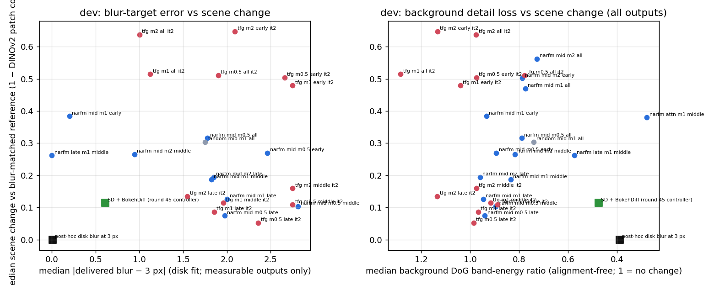

# Pareto pilot report (generated by report48.py)

## 1. Implementation checks

Stage status:

- `s0_env`: ok
- `s1_data`: ok
- `s1_refs`: ok
- `s1_validate`: ok
- `s2_narfm`: ok
- `s2_tfg`: ok
- `s3_smoke`: ok
- `s4a_layers`: ok
- `s4b_sweep`: ok
- `s4c_select`: ok
- `bscore_dev`: ok
- `s6_gate`: ok
- `s6_confirm`: ok (no method qualified for confirmation)
- `bscore_confirm`: not run

Environment: NVIDIA A30 MIG 2g.12gb (12 GB), torch 2.2.1+cu121, diffusers 0.30.3, transformers 4.44.2; NA-RFM 8e9619bc, TFG f8d17f3e.

CamEdit pairs: {"shard": "CamEdit_Focal_001", "n_rows": 3000, "n_scenes": 1942, "n_candidates": 955, "n_extracted": 955, "n_eligible": 321, "n_used": 321, "by_split": {"train": 221, "val": 49, "test": 51}, "r_median": 4.557163509256297, "reject": {"unmeasurable": 193, "r_out_of_range": 1.0, "near_blurred": 577}}

Measurement validation: {"a_diskfit": true, "a_preservation": true, "b_contrast_diskfit": true, "b_contrast_dog": 0.3600465951565617, "c_shift": true, "d_global": true}; disk-fit within tolerance [{"r": 1, "n_measurable": 11, "frac_within": 1.0}, {"r": 2, "n_measurable": 11, "frac_within": 1.0}, {"r": 3, "n_measurable": 11, "frac_within": 1.0}, {"r": 4, "n_measurable": 11, "frac_within": 1.0}, {"r": 6, "n_measurable": 11, "frac_within": 1.0}]; threshold changes {"iou": {"old": 0.75, "new": 0.75}, "shift": {"old": 16.0, "new": 36.72292780535337}}; blur numbers exploratory: False.

NA-RFM directions (scene-split):

| layer | D | val AUC raw / norm | test AUC raw | test paired acc | random val AUC (min, median, max) | cos with mean difference | eligible |
|---|---|---|---|---|---|---|---|
| mid | 81920 | 0.998 / 0.998 | 1.000 | 1.00 | [0.4389837567680133, 0.4970845481049563, 0.5247813411078717] | +0.934 | True |
| attn | 327680 | 0.995 / 0.995 | 1.000 | 1.00 | [0.3802582257392753, 0.49104539775093714, 0.6293211162015827] | +0.939 | True |
| late | 655360 | 0.999 / 0.999 | 1.000 | 1.00 | [0.4169096209912536, 0.5074968763015411, 0.6409829237817577] | +0.889 | True |

Noise-alignment filters: {"k_class": 220, "k_full": 441, "ev_class_top": 689.2635498046875, "ev_full_top": 609.1930541992188}

TFG predictor: 1073857 parameters, best val L1 0.39 px.
Validation (test scenes): blur Spearman 0.97, MAE r ≤ 4 0.33 px, contrast Δ 0.01 px (r = 4 response 3.84), median-filter Δ 1.19 (r = 2 response 1.61), category spread 0.07 px, real CamEdit pairs Spearman 0.79 (n 100, MAE 0.80 px). Gates: blur True, contrast True.

Smoke checks: {"baseline_repro_d01": true, "baseline_repro_d03": true, "narfm_zero_strength_exact_mid_d01": true, "narfm_w0_tol_mid_d01": true, "narfm_zero_strength_exact_mid_d03": true, "narfm_w0_tol_mid_d03": true, "narfm_hook_steps_mid": true, "narfm_zero_strength_exact_attn_d01": true, "narfm_w0_tol_attn_d01": true, "narfm_zero_strength_exact_attn_d03": true, "narfm_w0_tol_attn_d03": true, "narfm_hook_steps_attn": true, "narfm_zero_strength_exact_late_d01": true, "narfm_w0_tol_late_d01": true, "narfm_zero_strength_exact_late_d03": true, "narfm_w0_tol_late_d03": true, "narfm_hook_steps_late": true, "tfg_grad_finite_nonzero": true, "tfg_zero_tol_d01": true, "tfg_zero_tol_d03": true, "tfg_steps_m0_1_d01": true, "tfg_steps_m0_1_d03": true, "tfg_steps_m0_4_d01": true, "tfg_steps_m0_4_d03": true, "tfg_steps_m0_16_d01": true, "tfg_steps_m0_16_d03": true, "weights_unchanged": true, "memory_fits": true}

Smoke-set strengths: NA-RFM γ0 1.0 (NA/RFM norm ratio 0.48), grids {'mid': [0.5, 1.0, 2.0], 'attn': [0.5, 1.0, 2.0], 'late': [0.5, 1.0, 2.0]}; TFG m0 1.0 (weak: False), plan {'iter_steps': 2, 'n_cases': 12, 'strengths': [0.5, 1.0, 2.0], 'projected_h': 4.656150199638473}; reductions []; dtypes {'unet': 'torch.float16', 'vae': 'torch.float32'}; memory {'peak_gb': 10.308137893676758, 'total_gb': 11.75, 'name': 'NVIDIA A30 MIG 2g.12gb'}.

## 2. Development findings (12 dev prompt–seed pairs)

NA-RFM layer screen (dev 1-4, m = 1, middle): {"mid": {"n": 2, "mean_scene": 0.17648842930793762}, "attn": {"n": 1, "mean_scene": 0.3733617663383484}, "late": {"n": 1, "mean_scene": 0.2728932201862335}} → **mid**.

Every configuration (medians over cases; counts out of n):

| arm | n | blur measurable | blur response | on target (±1.33 px of 3) | median added blur r (px) | bg DoG ratio | scene change | subject DINOv2 | mask IoU | centre shift (px) | subject sharpness (log) | ΔE | depth ρ | preserved | response ∧ preserved | s / image | UNet fwd | UNet bwd |
|---|---|---|---|---|---|---|---|---|---|---|---|---|---|---|---|---|---|---|
| narfm attn m1 middle | 4 | 0 | 4 | 0 | – | 0.28 | 0.380 | 0.712 | 0.90 | 5.8 | -0.56 | 9.13 | 0.92 | 0 | 0 | 5.1 | 117 | 0 |
| narfm late m1 middle | 4 | 1 | 4 | 1 | 3.00 | 0.57 | 0.262 | 0.813 | 0.89 | 6.2 | -0.31 | 6.69 | 0.95 | 0 | 0 | 5.1 | 117 | 0 |
| narfm mid m0.5 all | 12 | 3 | 6 | 0 | 1.54 | 0.79 | 0.316 | 0.876 | 0.86 | 9.3 | -0.17 | 8.77 | 0.92 | 0 | 0 | 6.9 | 150 | 0 |
| narfm mid m0.5 early | 12 | 4 | 3 | 1 | 0.54 | 0.89 | 0.270 | 0.908 | 0.85 | 12.8 | -0.15 | 7.56 | 0.95 | 0 | 0 | 5.1 | 117 | 0 |
| narfm mid m0.5 late | 12 | 10 | 6 | 0 | 1.02 | 0.94 | 0.075 | 0.977 | 0.97 | 1.4 | -0.01 | 2.29 | 0.99 | 10 | 5 | 5.1 | 116 | 0 |
| narfm mid m0.5 middle | 12 | 10 | 2 | 1 | 0.19 | 0.89 | 0.104 | 0.976 | 0.97 | 1.6 | -0.04 | 2.38 | 0.99 | 7 | 2 | 5.1 | 117 | 0 |
| narfm mid m1 all | 12 | 0 | 7 | 0 | – | 0.77 | 0.470 | 0.738 | 0.71 | 38.7 | -0.13 | 15.10 | 0.86 | 0 | 0 | 6.9 | 150 | 0 |
| narfm mid m1 early | 12 | 1 | 5 | 1 | 3.20 | 0.93 | 0.384 | 0.754 | 0.74 | 18.3 | -0.13 | 14.76 | 0.86 | 0 | 0 | 5.1 | 117 | 0 |
| narfm mid m1 late | 12 | 6 | 3 | 0 | 1.00 | 0.95 | 0.126 | 0.964 | 0.96 | 2.0 | 0.01 | 3.21 | 0.98 | 7 | 3 | 5.1 | 116 | 0 |
| narfm mid m1 middle | 12 | 5 | 6 | 2 | 1.18 | 0.83 | 0.187 | 0.925 | 0.89 | 3.6 | -0.04 | 4.31 | 0.97 | 2 | 0 | 5.1 | 117 | 0 |
| narfm mid m2 all | 12 | 0 | 8 | 0 | – | 0.73 | 0.562 | 0.623 | 0.57 | 54.5 | -0.27 | 19.75 | 0.73 | 0 | 0 | 6.9 | 150 | 0 |
| narfm mid m2 early | 12 | 0 | 6 | 0 | – | 0.79 | 0.502 | 0.740 | 0.61 | 41.7 | -0.11 | 19.21 | 0.72 | 0 | 0 | 5.1 | 117 | 0 |
| narfm mid m2 late | 12 | 6 | 4 | 0 | 1.15 | 0.96 | 0.195 | 0.939 | 0.95 | 3.1 | 0.01 | 4.02 | 0.97 | 3 | 2 | 5.1 | 116 | 0 |
| narfm mid m2 middle | 12 | 1 | 6 | 1 | 3.94 | 0.82 | 0.265 | 0.888 | 0.93 | 3.1 | -0.05 | 6.55 | 0.93 | 0 | 0 | 5.1 | 117 | 0 |
| random mid m1 all | 12 | 3 | 10 | 0 | 1.25 | 0.74 | 0.304 | 0.882 | 0.86 | 12.8 | -0.10 | 9.85 | 0.92 | 0 | 0 | 6.9 | 150 | 0 |
| tfg m0.5 all it2 | 12 | 1 | 7 | 0 | 1.10 | 0.78 | 0.511 | 0.827 | 0.72 | 27.5 | 0.11 | 24.27 | 0.78 | 1 | 1 | 107.5 | 100 | 100 |
| tfg m0.5 early it2 | 12 | 2 | 5 | 0 | 0.34 | 0.97 | 0.504 | 0.840 | 0.69 | 18.3 | 0.03 | 23.40 | 0.75 | 1 | 0 | 39.3 | 100 | 34 |
| tfg m0.5 late it2 | 12 | 8 | 5 | 1 | 0.64 | 0.99 | 0.052 | 0.989 | 0.98 | 0.7 | 0.00 | 0.83 | 1.00 | 10 | 4 | 37.2 | 100 | 32 |
| tfg m0.5 middle it2 | 12 | 7 | 2 | 1 | 0.25 | 0.89 | 0.108 | 0.985 | 0.98 | 1.5 | 0.00 | 1.66 | 0.99 | 6 | 1 | 39.3 | 100 | 34 |
| tfg m1 all it2 | 12 | 1 | 4 | 1 | 1.87 | 1.28 | 0.514 | 0.751 | 0.53 | 43.6 | 0.10 | 27.59 | 0.63 | 0 | 0 | 107.5 | 100 | 100 |
| tfg m1 early it2 | 12 | 1 | 3 | 0 | 0.25 | 1.04 | 0.479 | 0.718 | 0.53 | 52.7 | -0.02 | 25.46 | 0.67 | 1 | 0 | 39.4 | 100 | 34 |
| tfg m1 late it2 | 12 | 7 | 5 | 1 | 1.15 | 0.97 | 0.087 | 0.980 | 0.98 | 0.8 | 0.01 | 1.37 | 0.99 | 9 | 4 | 37.3 | 100 | 32 |
| tfg m1 middle it2 | 12 | 7 | 4 | 1 | 1.04 | 0.92 | 0.114 | 0.979 | 0.96 | 1.3 | 0.01 | 2.67 | 0.99 | 6 | 2 | 39.4 | 100 | 34 |
| tfg m2 all it2 | 12 | 1 | 6 | 1 | 2.00 | 0.98 | 0.638 | 0.758 | 0.57 | 59.3 | -0.02 | 36.17 | 0.77 | 0 | 0 | 107.3 | 100 | 100 |
| tfg m2 early it2 | 12 | 1 | 3 | 0 | 0.91 | 1.13 | 0.647 | 0.698 | 0.24 | 93.3 | -0.05 | 33.08 | 0.62 | 1 | 0 | 39.4 | 100 | 34 |
| tfg m2 late it2 | 12 | 6 | 5 | 3 | 1.45 | 1.13 | 0.134 | 0.972 | 0.97 | 1.5 | 0.05 | 1.98 | 0.99 | 7 | 3 | 37.3 | 100 | 32 |
| tfg m2 middle it2 | 12 | 7 | 4 | 1 | 0.25 | 0.97 | 0.160 | 0.978 | 0.92 | 2.0 | 0.03 | 4.02 | 0.98 | 4 | 1 | 39.4 | 100 | 34 |
| SD + BokehDiff (round 45 controller) | 11 | 10 | 10 | 7 | 3.20 | 0.48 | 0.114 | 0.967 | 0.97 | 2.1 | -0.05 | 2.07 | 0.99 | 8 | 8 | 0.0 | – | – |
| post-hoc disk blur at 3 px | 12 | 11 | 11 | 11 | 3.01 | 0.39 | 0.000 | 1.000 | 0.96 | 2.0 | -0.00 | 1.25 | 0.98 | 10 | 9 | 0.1 | – | – |

- **narfm** selection: selected; P = `narfm|mid|m1|all`, B = `narfm|mid|m1|all`
- **tfg** selection: no repeatable response

Confirmation gate: {"narfm": {"go": false, "max_response": 8, "max_both": 5, "n_cases": 10, "need": 7}, "tfg": {"go": false, "why": "no repeatable response"}}

BokehDiff (dev): 11 rendered; ineligible (< 2 behind tiles, no gap): ['d10']; K: {'d01': 31.1, 'd02': 27.6, 'd03': 11.1, 'd04': 14.8, 'd05': 10.3, 'd06': 18.1, 'd07': 9.2, 'd08': 11.5, 'd09': 12.3, 'd11': 10.6, 'd12': 14.7}; clipped []; flags {}.

Matched-blur comparisons against SD + BokehDiff (dev; paired differences, method − BokehDiff, mean [95% bootstrap]):

- narfm P: n matched 0; scene (nan, nan, nan); subject DINOv2 (nan, nan, nan); subject sharpness (nan, nan, nan); unmatched 11

Grids: `grid_dev_0.jpg`, `grid_dev_1.jpg` (label: measured added blur r, scene change, P = preserved).

## 3. Held-out confirmation (12 confirm prompts)

Not run: no method qualified for confirmation.

## 4. Verdicts (README rule 7)

- **narfm**: no advantage established (dev: did not pass the confirmation gate; max response 8/12, max response ∧ preserved 5/12)
- **tfg**: no advantage established (dev: no repeatable response; max response None/12, max response ∧ preserved None/12)
